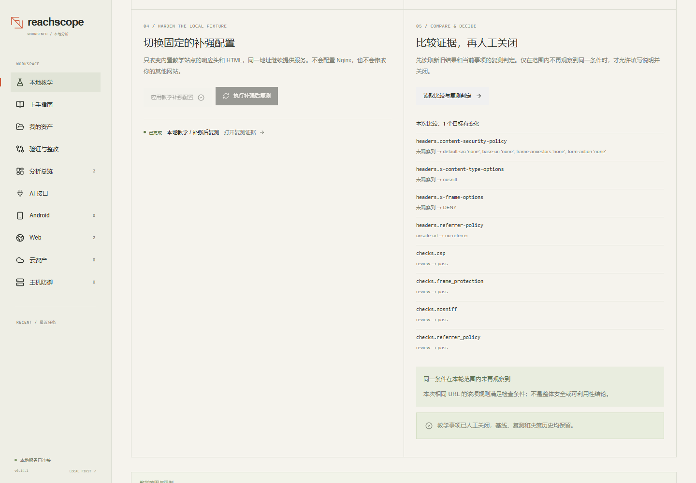

# ReachScope Workbench

[](https://github.com/tubibibo/reachscope-workbench/actions/workflows/ci.yml)

**A local, single-user workbench that turns security findings into evidence,
remediation, and a verified close.**

> Status: 0.15.0, maintained by one person. Bug reports and feature suggestions
> are welcome; see [CONTRIBUTING.md](CONTRIBUTING.md).

> This repository begins at 0.14.1 in a single commit. The project was developed
> privately before publication; [CHANGELOG.md](CHANGELOG.md) records that history,
> and no earlier version was published here. Source comments may reference
> internal planning identifiers that are not part of this repository.

English | [简体中文](README.zh-CN.md)



## Why it exists

Most security tools stop at the finding. ReachScope Workbench carries the result
one step further: the same evidence can enter a remediation workspace, be assigned,
be re-tested against a comparable condition, and only then be closed by a human.

Four analysis modules — Android, Web, Cloud, Host — share one job queue, one
evidence structure, one SQLite workspace and one frontend. A check you run today
is still there after a restart, and a re-test is compared against the exact
observation it is meant to replace.

## Who it is for

- **A site owner or solo developer.** Point it at the URLs you actually run, get
  configuration problems with the evidence behind each one, then re-check after
  you fix them and close the item by hand.
- **A penetration tester.** Keep scope, raw response, candidate lead and
  verification note in one place, so a finding survives the hand-off into a
  report.
- **A student.** The [teaching lab](#the-teaching-lab) is a real site on
  loopback: collect, harden, re-test, compare. Every number on screen comes from
  an actual HTTP response, and nothing leaves your machine.
- **A teacher.** The same lab runs offline and returns the same result every
  time, so a class sees the same cause and the same effect.

## Scope and limits

- **Not a vulnerability scanner.** Leads, imported findings and rule
  suggestions are never presented as confirmed vulnerabilities.
- **Not an attack tool.** No crawling, brute forcing, exploit or APK
  execution. Web probing sends a bounded GET to the URLs you list; private
  targets stay disabled unless you opt in.
- **Not a hosted service.** Loopback only, one local operator, no accounts or
  isolation. Do not expose the port through a public reverse proxy.
- **No measured detection rate.** The rule tables are a reading aid for a
  human, not steps the application performs. Nothing here is validated against
  a realistic corpus, and a missing observation is not evidence that an asset
  is safe.
- **It does not read your cloud account.** The cloud module parses offline
  JSON; a static configuration proves nothing about deployed reachability.

## Quick start

**Windows** — from the repository root:

```powershell
.\start-workbench.ps1
```

**Other platforms:**

```bash
python -m venv .venv
# Activate .venv using your shell.
python -m pip install .
reachscope-workbench doctor --data .workbench
reachscope-workbench serve --port 8765 --data .workbench
```

**Docker** — the application binds loopback only by design, so it needs host
networking rather than port mapping:

```bash
docker build -t reachscope-workbench .
docker run --rm -it --network host \
  -v "$PWD/.workbench:/app/.workbench" reachscope-workbench
```

Then open **http://127.0.0.1:8765**.

Host networking requires Docker Engine on Linux, or Docker Desktop 4.34+ with Linux containers and host networking enabled in Settings > Resources > Network. It is incompatible with Enhanced Container Isolation.

The frontend is prebuilt and ships in the repository — no Node.js required.
No AI key, no scanning API key, no account.

## The teaching lab

Open **http://127.0.0.1:8765/#/lab** for a real site running on loopback, and
walk the whole loop on it: collect a baseline, apply one explicit hardening
change, re-test the same URL, compare the two observations field by field, and
close the item by hand.

Every number on screen comes from an actual HTTP response. Nothing is
downloaded, no APK or Java is needed, and no machine other than yours is
contacted. The result is the same on every run, which is what makes it usable
in front of a class.

## More samples

| Entry | What you get |
|---|---|
| Android samples (5) | Cross-component, JS bridge, permission leak, key mismatch, missing component. No APK or Java needed. |
| Cloud sample | `examples/cloud/aws-plan.synthetic.json` |

## What it does

| Module | Input | Output |
|---|---|---|
| Android client | APK upload / 5 source samples | Configuration review, components, permissions, deep links, candidate paths, source lookup, comparable re-test |
| Web probing | Up to 20 exact HTTP(S) URLs | Status, title, server, IP, TLS, redirects, headers, timing, body summary |
| Web review & history | Imported scan results, two completed probes | Fingerprint grouping, config checks, cookie/form profile, field-level change between runs |
| Cloud configuration | AWS Terraform Plan / IAM / supported export JSON | Network, permission and storage rules with field-level evidence and implementation guidance |
| Host defense | SSH/Nginx config JSON, Nginx access logs, SSH auth logs | 7 baseline checks, 3 bounded log rules, redacted events, reinforcement guidance, config re-test |
| Shared workbench | Any of the above | Job progress, logs, cancellation, history, evidence query, JSON / HTML / CSV export |

## Documentation

Full documentation is written in Chinese — start at [docs/](docs/README.md).

The English README is a curated summary, not a translation; where the two differ,
the Chinese documentation is authoritative.

- [Project status](docs/releases/project-status.md) · [Feature matrix](docs/reference/feature-matrix.json)
- [Architecture](docs/architecture/workbench.md) · [API reference](docs/reference/workbench-api.md)
- [Quality gates](docs/development/quality-gates.md) · [Security model](SECURITY.md)
- [Third-party sources](THIRD_PARTY.md)

## Development

```bash
python -m pip install -e ".[dev,ui]"
cd frontend && npm ci && npm run check && npm run build && cd ..
python scripts/check_all.py
```

`scripts/check_all.py` runs the repository gate, ruff, strict mypy, the test suite
with an 85% coverage floor, the OpenAPI drift check, and the frontend type check
and build. CI runs the same set on Ubuntu and Windows across Python 3.11 and 3.13.

## License

MIT. See [LICENSE](LICENSE) and [THIRD_PARTY.md](THIRD_PARTY.md).
