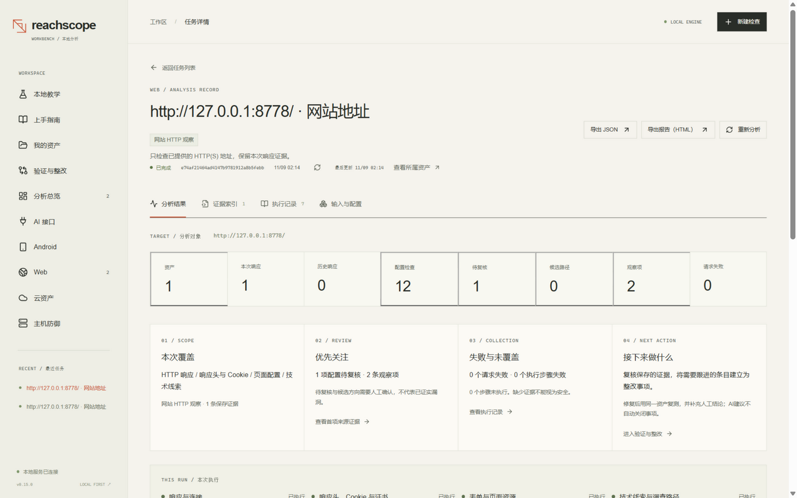
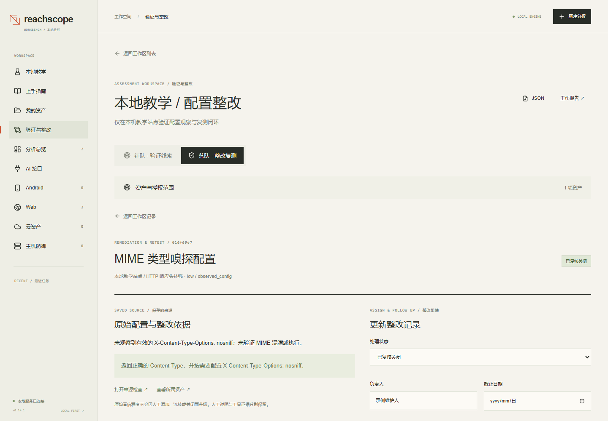
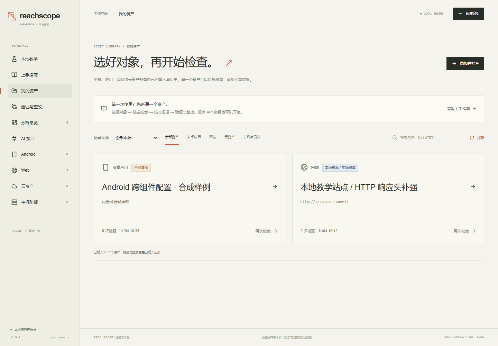
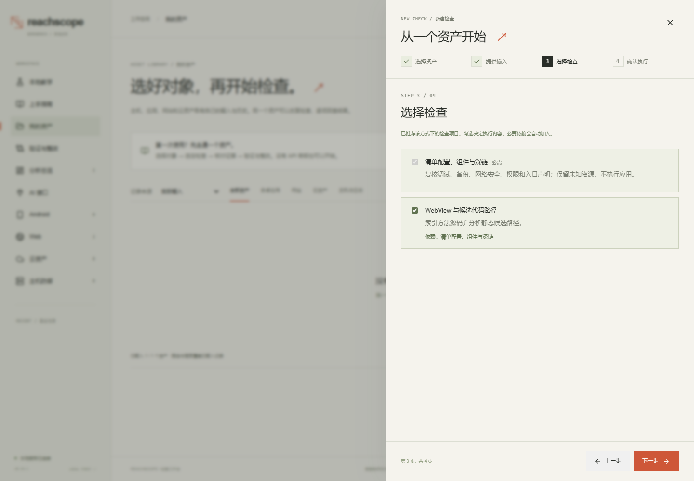
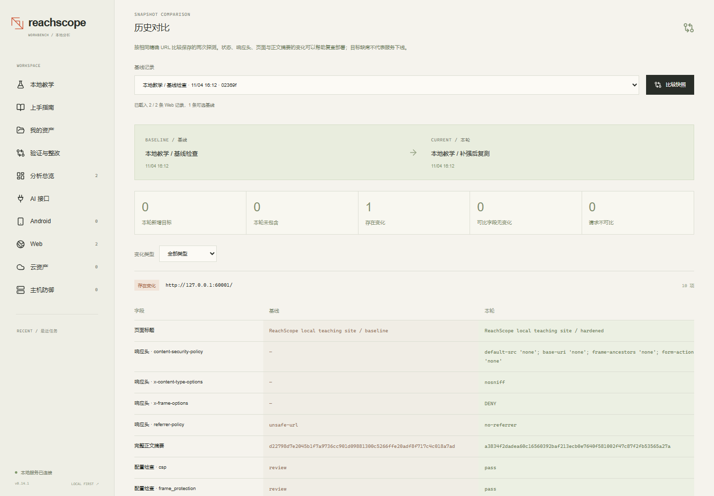
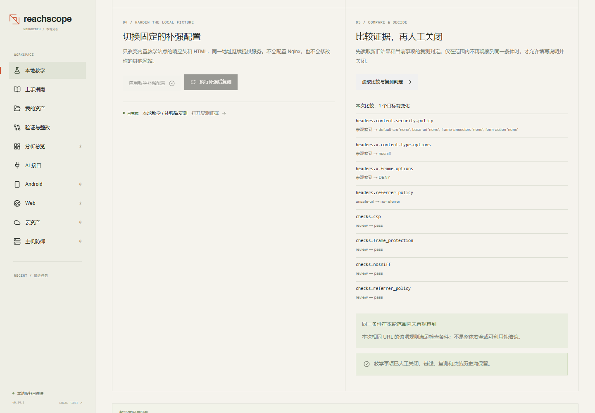

# ReachScope Workbench

[](https://github.com/tubibibo/reachscope-workbench/actions/workflows/ci.yml)

[文档导航](docs/README.md) · [目录与命名规范](docs/development/repository-layout.md) ·
[开发命令](scripts/README.md)。源代码、测试、文档和本地产物按职责分开；历史日志集中归档。

Current scope and verification: [project status](docs/releases/project-status.md) ·
[feature matrix](docs/reference/feature-matrix.json) · [AI/Web experiment](docs/modules/web/ai-advisory.md).

> 本仓库从 0.14.1 起以单条提交公开；此前在私有副本中开发，[CHANGELOG.md](CHANGELOG.md)
> 记录了那段历史，更早的版本从未在此发布。源码注释中可能出现未随仓库发布的内部规划编号。

**0.15.0 场景包：** 教学场景改为数据化包（YAML + 静态页面），内置三个教学场景；
新增 `GET /api/lab/scenarios` 与 `--scenarios-dir`；provenance 记录 `scenario_id`；见 [CHANGELOG.md](CHANGELOG.md)。

**0.14.2 发布卫生：** 版本号、CI 配置与文档更新，无功能变化；见 [CHANGELOG.md](CHANGELOG.md)。

**0.14.1 安全加固：** [专项安全测试日志](docs/security/security-test-log-2026-11-02.md)。
修复导入资料歧义、敏感字段/未知标记保护、AI 草稿目的地与摘要授权绑定、
案例并发决策和子进程诊断预算；扫描告警、确认问题、硬化项和剩余依赖风险分别记录。

**0.14 功能：** [主机资料采集与边界](docs/modules/host/collector.md) · [架构决策](docs/architecture/adr/0014-host-collection-journey.md) ·
[五分钟上手](docs/getting-started/quickstart.md) · [项目状态](docs/releases/project-status.md)。
新增可审阅的独立主机采集器：先预览计划，明确确认后导出支持的最小配置字段，
再手动上传、预览并检查。主机结果可沿用既有工作区建立整改事项，按步骤关联修订资料、
复测和人工关闭。采集失败保持未知；声明的身份和时间不证明运行态。基础能力无需 AI。



**60 秒上手**：完成下方快速启动后，打开 **http://127.0.0.1:8765/#/lab** ——
一个真跑在本机回环上的小站点，零配置，数据不出机器。

**Android / Web / Cloud / Host evidence, shared red/blue review and remediation.**

ReachScope Workbench 是面向开发者与蓝队人员的本地安全加固、证据复核和整改验证工具。按 **选择资产 → 提供输入 → 选择检查 →
确认执行** 四步操作，资产保存后可以再次检查，各次结果和证据分别归档。
四个独立分析模块共用任务队列、证据结构、数据库、导出和前端；命令行保留已有
Android 引擎入口，API 可供脚本或 AI 读取。

## 适合谁用

- **个人站长 / 独立开发者**：把你真正在跑的网址填进去，拿到一份带证据的配置问题清单；
  修完再复查一次，确认关闭。
- **渗透测试人员**：范围、原始响应、候选线索、复验记录放在同一处，交接给报告时不会散。
- **学生**：内置[教学实验室](#教学实验室)是一个真跑在本机的小站，可以完整走一遍
  采集、加固、复测、对比，屏幕上的每个数字都来自真实 HTTP 响应。
- **老师**：同一个实验室离线可跑、每次结果一致，课堂上演示的因果固定，不会翻车。

同一份资产和分析结果现在可进入「验证与整改」工作区：红队整理范围、候选线索、
原始证据和人工验证记录；蓝队指定负责人、跟踪处理决定、对比复测并人工关闭。
它们共享可追溯来源和审计历史，不会因为切换视角就把推断升级为已确认漏洞。
详见 [红蓝协作工作流](docs/getting-started/red-blue-workflow.md)。



提交前会检查保存文件及本机前置条件。资产/检查的同一次操作因断线或客户端等待
超时而重试时，使用原操作标识取回记录；不会自动重复发送检查。
详见 [接口与工程审查](docs/releases/reviews/reliability-0-7-1.md)。



现在可以按资产逐步选择真正要执行的检查：



> 文档截图包含历史版本的功能示意；当前版本与适用范围以项目状态和功能矩阵为准。

## 现在能做什么

| 模块 | 输入 | 实际输出 |
|---|---|---|
| Android 客户端 | APK 上传 / 5 个源码样例 | 八类配置复核、组件/权限/深链、候选路径、源码、人工补强与可比复测 |
| Web 探测 | 精确 HTTP(S) URL 列表 | 实际响应状态、标题、服务器、IP、TLS、重定向、响应头、耗时与正文摘要 |
| Web 导入与整理 | JSON / CSV / httpx 或 Nuclei JSONL | 指纹分类、资产分组、导入记录和候选调查路径 |
| Web 响应复核 | 已采集的 HTTP 响应 | 配置检查、无值 Cookie 属性、HTML 表单与资源画像 |
| Web 历史对比 | 两个已完成的 URL 探测任务 | 同 URL 字段变化、输入集合变化与不可比记录 |
| 云服务观察 | 服务器上的精确 HTTP(S) 服务地址 | Web 响应与配置证据，归档在云资产下 |
| 云配置审查 | AWS Terraform Plan / IAM / 支持的配置导出 JSON | 执行前覆盖预览、网络/权限/存储规则、字段证据与人工实施指南 |
| 主机防御 | SSH/Nginx 配置 JSON、Nginx 访问日志、SSH 认证日志 | 7 条配置基线、3 条有限日志规则、脱敏事件、补强指引与配置复测 |
| 我的资产 | APK、网站、云服务、主机配置或日志文件 | 保存输入、选择下次检查项目、关联各次历史 |
| 红队验证视角 | 固定范围中的已完成检查 | 选择有证据的候选、读取原始依据、记录验证意见与不确定性 |
| 蓝队整改视角 | 同一工作区的线索 | 负责人、期限、处理状态、修订文件、可比复测与人工关闭 |
| Web AI 研判试点 | 已完成的网站 URL 检查 + 自选兼容模型 API | 脱敏摘要预览、受控目录排序、红队人工核查方向与蓝队补强清单 |
| 共用工作台 | 全部模块 | 实时进度、日志、取消、重试、历史任务、证据查询、JSON / HTML 报告 |

这里不把安全头缺失当成已确认漏洞，也不把规则推荐的调查路径当成已经打通的链。
Android 的路径来自有边界的静态分析；导入的扫描结果明确标为未复核。

Web 历史对比示例（两次真实本机样例响应采集）：



## Docker

应用仅监听本机回环地址，因此容器须使用 host 网络而不是端口映射。Linux 需要 Docker Engine；Docker Desktop 需要 4.34 或更高版本、Linux 容器，并在 Settings > Resources > Network 中启用 host networking。此模式与 Enhanced Container Isolation 不兼容。

```bash
docker build -t reachscope-workbench .
docker run --rm -it --network host -v "$PWD/.workbench:/app/.workbench" reachscope-workbench
```

本次尚未在本机 Docker daemon 上构建或运行镜像。

## 直接启动

本仓库已包含编译好的前端。Python **3.11+**。首次安装会下载依赖。

在仓库根目录打开 Windows PowerShell 并运行：

```powershell
.\start-workbench.ps1
```

打开 **http://127.0.0.1:8765**。脚本只在缺少虚拟环境时安装；已有 sibling
`tools/apktool*.jar` 可自动作为本地解码器。服务默认只监听本机。

跨平台安装：

```bash
python -m venv .venv
# Activate .venv using your shell.
python -m pip install .
reachscope-workbench doctor --data .workbench
reachscope-workbench serve --port 8765 --data .workbench
```

无需模型账号或 FOFA key，也没有遥测——完整的出站网络行为清单见
[docs/reference/network-behavior.md](docs/reference/network-behavior.md)。
Web URL 探测会向你明确提交的地址发送 GET 请求；
选择私网目标需打开表单中的本地/私网选项。离线样例和文件导入不发送探测流量。

### 教学实验室



打开 **http://127.0.0.1:8765/#/lab**，那是一个真跑在本机回环上的小站点。可以亲手走完
「采集基线 → 应用一处明确的加固 → 对同一 URL 复测 → 逐字段对比 → 人工关闭」。

屏幕上的每个数字都来自一次真实的 HTTP 响应。不下载任何东西，不需要 APK 或 Java，
不接触本机以外的任何目标；每次运行结果一致，因此可以反复演示。

其他样例：Android 的“跨组件”样例、Web 的离线资产样例。它们都使用随项目分发的合成输入，
不准备 APK 或目标站点也能把整个流程走一遍。

Android 样例无需 Java。真实 APK 需要 Java 与 [Apktool](https://apktool.org/)：
在界面选择 JAR 路径，或设置 `APKTOOL_JAR`。工具不安装或执行目标 APK。

## 使用工作流

1. 点击“新建分析”，选择安卓应用、网站、云资产、主机防御，或选一个已经保存的资产。
2. 按步骤提供文件/地址，勾选检查项目，确认范围后执行；“我的资产”可再次使用输入。
3. 查看执行范围、任务进度和日志。未选项目实际跳过；失败保留错误，重试产生新任务。
4. Android 在组件和候选路径之间浏览，读取对应方法代码；只选清单时不建源码索引。
   Web 查看资产响应、
   配置检查、表单/资源画像、指纹线索和规则建议。每项都能回到它的证据。
5. Web URL 探测可选择另一已完成探测作基线，查看字段变化；新增/移除指输入 URL 集合，
   失败请求与旧版未采集字段会明确标注。详见 [Web 工作流](docs/modules/web/workflow.md)。
6. 云配置查看资源、检查与原始字段依据。仅服务器地址不能读取 IAM 或安全组配置。
7. 导出 JSON 供脚本/AI 使用、HTML 供人阅读，或导出 Web 资产 CSV。刷新页面、重启服务后历史仍在。
8. 打开「验证与整改」，新建工作区并明确本次范围；从范围内已完成检查中添加线索。
   在红队视角阅读证据、记录验证；切到蓝队视角分配负责人和期限。再次检查原资产，
   或显式关联同格式的本地修订文件，预览复测后填写依据。只有可比复测未再观察到
   原条件才允许人工标记「已复核关闭」，缺失资源、失败请求和未知字段不会视为修复。

[资产与检查流程](docs/getting-started/asset-workflow.md) · [云模块范围与输入](docs/modules/cloud/configuration-review.md)

任务、上传文件、SQLite 数据和源码证据位于 `--data` 指定目录，默认 `.workbench/`。
它们可能含敏感应用代码，不进入 Git。停止服务后再备份或清理该目录。

## 软件结构

```text
src/
  reachscope/                     既有 Android 引擎、工件与查询 API
  reachscope_workbench/
    core/                         领域契约、资产/检查、协作与复测用例、SQLite、队列、锁
    modules/android/              引擎适配、独立进程、进程树取消
    modules/web/                  探测、范围控制、文件导入、规则适配
      legacy/                     隔离的规则与分类组件
    modules/cloud/                离线 AWS 资源归一化、字段脱敏与有限规则
    api/                          HTTP 接口、上传、报告和本地请求边界
    static/                       编译后的前端资源
frontend/src/                     React / TypeScript 组件、类型、API、hooks
```

新增模块实现 `AnalysisModule` 并显式注册。模块之间没有互相导入，也不依赖
HTTP 或前端。SQLite 条件状态转换防止任务取消后被迟到结果改成成功。Android
工作进程可超时、取消并清理 Java 后代；Web 连接绑定经过校验的 DNS 地址。

[架构与取舍](docs/architecture/workbench.md) · [API 合同](docs/reference/workbench-api.md)
· [工程验收](docs/releases/validation/workbench.md)

## 开发与检查

```bash
python -m pip install -e ".[dev,ui]"
cd frontend
npm ci
npm run check
npm run build
cd ..
python scripts/check.py
# Or run backend + frontend checks together:
python scripts/check_all.py
```

前端开发：`npm run dev`（Vite 代理 `/api` 到本机 8765）；生产由同一个 Python
服务提供静态前端。`package-lock.json` 锁定 npm 依赖，`requirements.lock` 记录
本次 Python 验收版本。CI 配置包含 lint、strict mypy、覆盖率门禁、生成请求类型漂移、前端构建、
安装 wheel 后的实际 API 冒烟，以及独立的隔离浏览器 job；远程 runner 尚未实际执行。

旧引擎仍可独立使用：`reachscope index`、`scan`、`query`、`demo`。它的 API 与
历史评测文档仍保留，旧计划文档不代表新工作台已完成或将要完成的功能。

## 成熟项目与来源

- [FastAPI full-stack template](https://github.com/fastapi/full-stack-fastapi-template)：
  参考类型化前后端、应用组织及构建交付方式；本项目没有照搬其账号/云部署体系。
- [ProjectDiscovery httpx](https://github.com/projectdiscovery/httpx)：参考按目标记录探测
  元数据、明确探测能力和范围；当前使用 Python HTTPX 实现有限探测，并兼容其 JSONL。
- [ProjectDiscovery Nuclei](https://github.com/projectdiscovery/nuclei)：参考结构化结果导入；
  不下载或执行其漏洞模板，导入 finding 不自动升级为已验证结果。
- DefectDojo、Prowler、Checkov：参考资产/测试分离、检查分类、资源和字段证据组织；
  这次没有引入其执行器、源码或规则库，见 [参考决策](docs/research/open-source-references.md)。

这些是经过核对的设计参考或明确的本地代码复用，不代表本项目具备上游全部能力。

## 边界

当前是本机单用户工具，非公网托管平台。Web 探测最多 20 个精确 URL，不爬站、
不爆破目录或执行漏洞利用。内部地址默认关闭；每个重定向检查目标范围。
随附的调查规则表是**给人阅读的核查清单**：写明该看哪些位置、什么算有结果、
什么算假点。应用本身不执行其中任何一步，那些文字需要使用者自己判断和动手。
Android 仍受深度、组件跳数、分支、反射、JNI 和异步语义限制。首次大型 APK
分析可能需要较长时间。没有用小样例或覆盖率宣称现实检出率。
云配置模块当前支持有限 AWS JSON 结构，不连接云账号；静态文件不证明部署状态、
完整有效权限或实际公网连通性。只检查勾选的规则组，未知和未支持项明确保留。
红蓝视角不是账号角色或多人权限隔离；人工负责人只是记录字段。工作区保存的范围说明
不证明外部法律授权。APK 静态线索和导入发现可用于人工跟踪，但大多不具备自动判定
整改的可比条件；仍明确显示不可比。复测未观察到某个条件也不代表整个资产安全。

AI 目前只支持真实网站 URL 检查，Android/云 AI 适配仍在规划中。模型只选择控制目录
和已有证据 ID；应用从原创、公开归因的目录呈现建议，拒绝任意模型指令、未知引用、
截断或工具调用。Kaspersky 资料仅用于端点纵深防护的公开原则参考，不读取本机专有规则，
不复刻杀软功能；网站配置与终端治理分别标注，详见
[公开防护资料](docs/reference/defense-references.md)。

MIT · [贡献指南](CONTRIBUTING.md) · [安全模型](SECURITY.md)
