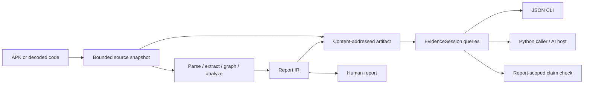

# Architecture

This document describes the retained Android engine. For the current application,
module boundaries, job lifecycle and frontend see [Workbench architecture](workbench.md).

## One analysis core, multiple consumers

No analysis module depends on a model SDK, MCP or a web server. All tool output
remains data. Target strings and comments never become host instructions.

## Responsibilities

| Layer | Responsibility | Allowed project dependencies |
|---|---|---|
| `_version`, `exitcodes` | Constants | None |
| `ir` | Data structures and stable serialization | Version constants |
| `ingest` | APK validation, decoder invocation, Manifest/smali parsing | IR, exit codes |
| `graph` | Register flow and bounded call graph | Ingest, IR |
| `extract` | Components, WebViews, bridges, origin checks, sinks | Ingest, graph, IR |
| `analyze` | Assemble candidate paths and separate legacy risk judgments | Lower analysis layers |
| `report` | JSON and HTML presentation | IR, version constants |
| `protocol` | Claims, assumptions, report-scoped checks and missing facts | IR |
| `artifacts` | Snapshots, identities, method locations, integrity and budgets | Ingest, IR, report, version |
| `query` | Small paginated views over an existing artifact | Artifacts, IR, protocol |
| `application` | Decoded-input use case | Analysis, artifacts, IR |
| `demo` | Recorded synthetic walkthrough | Application, query, artifacts |
| CLI adapters | Parse arguments, map errors, emit output | Application and query APIs; legacy scan wiring |

Architecture tests resolve both relative and absolute imports. Tests are a
dependency contract; intentional changes require updating this table and the
tests together. Library imports must not perform filesystem work or print.

## Identity and persistence

An artifact's identity covers source inventory/content, versions, analysis
configuration, limitations, warnings, method index and normalized report semantics.
Machine-specific input paths and analysis timestamps do not change semantic
identity. A new configuration or source snapshot creates a new artifact.

Publication uses a staging directory and an atomic rename. Concurrent creators
may share the same completed artifact; incomplete staging directories are ignored.
The store verifies schemas, metadata/report/index hashes, source hashes and path
boundaries. These hashes establish internal consistency, not third-party trust.

Decoded input is copied into a bounded snapshot before analysis. The report and
retained code are therefore derived from the same snapshot even if the original
directory changes. Optional `apktool.yml` is retained because it may carry SDK
metadata omitted from the decoded Manifest. Resources and native libraries are
not copied. Source budget defaults: 256 MiB total, 32 MiB per file, 100,000 files.
APK archive preflight also bounds file count and declared expansion; it is not
a decoder sandbox or an OS memory limit.

## Evidence and certainty

Code location, inferred data path and risk judgment are distinct query fields.
The inherited analyzer still computes risk rules, but claim checks no longer
require bridge-specific risk conditions for a non-bridge path. Existing report
snapshots remain useful without changing the whole analysis IR.

`SUPPORTED` refers to the recorded static candidate path, not an independently
proven execution. A report mismatch cannot refute actual program behavior. Direct
Manifest access conditions can refute only the named zero-permission entry premise.
Warnings and missing evidence remain visible; model answers remain assumptions.

## Deliberate tradeoffs

- Files and JSON instead of a database: inspectable and sufficient for local use.
- CLI/Python before network adapters: one implementation, fewer runtime concerns.
- Reuse the existing narrow analyzer: spend effort on evidence quality and tests.
- Validate the full artifact on open: more I/O, stronger corruption detection.
  Reuse an EvidenceSession rather than cold-opening for every question.
- One extra index pass currently records method boundaries. A shared analysis
  context can remove this cost after profiling without changing public queries.
- No model-based success claim: actual assistance must be established with an
  independent held-out comparison rather than sample regressions.

Old `docs/dev/` plans are historical. They do not override this design or the
current public response contracts.
