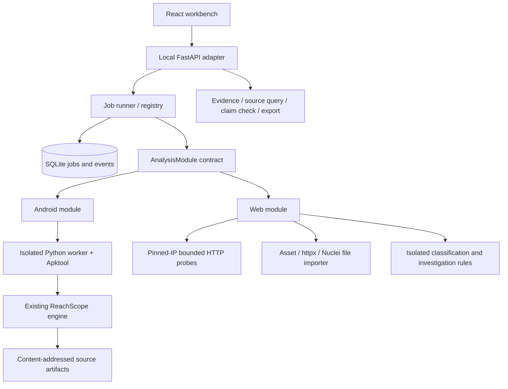

# Workbench architecture

The new application lives in `reachscope_workbench`; the existing `reachscope`
package remains an independently callable Android engine. The frontend is a
React/TypeScript/Vite application compiled into Python package static assets.

Version 0.11 remains a modular monolith with explicit module registration. The
getting-started page navigates actual asset/check use cases; module-specific
routes preserve selection on refresh/back. CLI doctor reads local prerequisites
without creating the workspace or contacting a target/provider.

Version 0.7 adds an asset-first catalogue and four-step wizard. Persistent assets
and immutable inspection runs are separate; normalized source input is bound to
each job with a snapshot. See [asset workflow](../getting-started/asset-workflow.md).

## Dependency direction

`core.models` contains stdlib-only protocols/dataclasses. Modules depend on these
contracts; they do not import FastAPI, the API package or one another. The registry
has explicit implementations, not dynamic execution of arbitrary plugin files.
HTTP validation, upload streaming, response headers and presentation belong to
the API. The frontend consumes typed contracts rather than importing Python internals.
Architecture tests inspect both absolute and relative imports.

Adding a module requires a unique `ModuleSpec`, deterministic input validation and
`run(config, context) -> ModuleResult`, followed by explicit registration. A module
provides summary, evidence, observations, detailed records and limitations. These
shared fields enable task/report/evidence views without equating Web heuristics
with Android source analysis. No universal vulnerability score is invented.

## Durable task state

Each task has its own workspace and immutable configuration. SQLite schema v6
stores task status, timestamped events, upload metadata and completed result JSON.
Connections are short-lived and foreign-key enabled; updates use transactions and
conditional state transitions. Terminal jobs cannot be overwritten by late callbacks.
Progress is monotonic in the job row. JSON exports contain the full recorded result.

The queue has at most 100 waiting jobs and two active workers. Cancellation updates
state, cancels the active coroutine and cleans Android's worker/decoder process tree.
Retry creates a new task ID. A workspace lock allows only one server process to own
a data directory; this is a local tool, not a distributed queue. After restart,
unfinished running tasks are marked interrupted, while queued tasks are recovered.
No interrupted task is silently called successful.

The additive v1-to-v2 migration creates assets and job associations while retaining
legacy tasks without an invented asset. Job creation and the asset snapshot share
a transaction. The catalogue maps user-facing kinds to compatible modules, modes
and check dependencies without importing module code. Cloud external observations
can therefore use Web execution without coupling the two module implementations.

Maintenance 0.7.1 upgrades to schema v3 with durable request identities for assets
and jobs. Create-or-replay is one transaction; normalized input fingerprints reject
conflicting key reuse. SQLite waits run in threads for HTTP commands, worker state
and ordered progress writes. Queue mutation and cancellation stay on the owning
event loop. Submission reserves capacity and completes durable-write/queue
finalization even when the requesting client disconnects. Start/stop rebuild
loop-bound objects and clean up interrupted partial starts.

The HTTP layer's `contracts` and `errors` modules own bounded request validation,
public envelopes and correlation IDs. `core.inspections` is the application use
case for preparing saved inputs and local preflight; it imports neither HTTP nor
concrete analysis implementations. The preferred inspection route obtains its
module/input on the server instead of trusting a client's duplicate reconstruction.
Preflight hashes files in a thread, performs no target traffic and does not
replace module validation or guarantee future environment consistency.

## Scoped red/blue collaboration

Red and blue are local presentation perspectives over the same evidence and cases,
not accounts, authenticated roles or permission boundaries. A collaboration
engagement holds its objective, operator-supplied authorization note and fixed
saved-asset scope. The note records context; it cannot establish legal authority.
Scope cannot be expanded by editing a case or linking a later input.

Schema v4 adds engagements, immutable engagement/asset associations, cases,
append-only case events, separate engagement/case operation identities and explicit
case-local retest-input associations. Migrations from v1/v2/v3 are additive and
preserve job history; future schemas are rejected before writes. Cases reference
the original completed job, actual bound asset, stable source reference and source
kind. A unique engagement/job/source-kind/source-reference constraint prevents
duplicate promotion, while persisted idempotency keys recover lost create responses.

`core.case_sources` is a pure reader over persisted results. It derives candidates
from evidence-backed structured checks/observations and compares only supported
saved conditions. It performs no network traffic or exploit verification.
`core.case_service` applies use-case rules: fixed scope, persisted source validation,
compatible retest inputs, conservative comparison and explicit decision evidence.
`core.collaboration` owns bounded values, transactionally consistent paged reads,
prepared SQL, compare-and-swap writes and JSON audit events. Neither core layer
imports the HTTP API or a concrete analysis module. `api.collaboration` adapts
strict request contracts and runs synchronous work in threads.

Every case mutation supplies `expected_version`; a stale write returns
`CASE_CONFLICT`, without overwriting another decision. The case version and its
audit event commit together. Status, owner, due date, note, recorded retest and
revised-input association are auditable. A local operator still controls the
SQLite files; this is application history, not a signed tamper-proof audit log.

A retest reads another completed inspection; it never starts one implicitly.
Outcomes are `still_observed`, `not_observed_in_scope` or `not_comparable`.
Missing resources, failed requests, skipped groups, unknown/truncated fields and
unsupported comparisons cannot clear a case. Cloud comparison requires the same
resource identity/type and supported rule. Web comparison requires the same
saved asset, exact URL, rule, successful collection and complete relevant evidence.
Android paths and imported scanner findings remain manual-review evidence.

Resolving a case requires a comparable `not_observed_in_scope` result and a new
human explanation in the same decision command. The server recomputes the
comparison from saved evidence; it does not accept a client-supplied outcome.
Accepted-risk and false-positive decisions also require a new explanation.
Reopening a final decision requires a reason. No comparison automatically closes
a case or establishes exploitability, overall safety or effective cloud access.

An immutable local APK/JSON asset can have a new same-kind, same-profile local
file explicitly associated with one case for retesting. The association records
the operator's resource-identity explanation and does not replace the original
asset/job, add the new asset to engagement scope or allow new cases from it.
Network addresses and demonstration profiles cannot use this revision mechanism.

Case timelines page forward by event ID with a maximum of 100 entries. Case
detail includes the first 100 events and a continuation cursor, not a complete
unbounded history. Engagement exports contain at most 500 cases and 8 MiB of
serialized case data and report truncation in `export_scope`; per-case timelines
retain the same first-page/cursor contract. The export is assembled from saved
reads, not a database-wide atomic snapshot. See [workflow](../getting-started/red-blue-workflow.md)
and [API](../reference/workbench-api.md) for operator and integration contracts.

## Module execution

Android analyzes uploaded APKs or bundled source samples using the retained engine
in a separate process. Windows Job Objects / POSIX process groups control descendants;
timeouts include worker pipes, not just the initial parent. Logs have bounded tails.
Artifact methods are queried through the engine's verified evidence store. No APK is
installed or executed. The shared module result explicitly caps large inventories.

Web sends GET only to the supplied exact URLs and allowed redirects. The URL parser,
network policy and pinned DNS addresses precede connections. Host and TLS SNI remain
the original hostname; proxies are disabled. Each hop rechecks scope. By default,
private addresses are refused; enabling private targets does not enable metadata,
multicast or unspecified addresses. Request/body/deadline/concurrency budgets are
explicit. There is no directory brute force, port sweep or exploit execution.

Response analysis is a separate pure-data layer: bounded HTML parsing and
configuration checks consume captured bytes/headers, with no secondary requests.
Cookie values and raw Set-Cookie are not persisted in response metadata. A saved
comparison module consumes two completed probe results, aligns exact URLs and
preserves collection uncertainty; it never re-probes targets or rewrites history.
CSV export is a Web-specific adapter, while lossless JSON remains the shared
result transport. The frontend can render old results without the new fields.

File imports never send network requests. Imported status codes and findings stay
historical/unverified. The rule implementation is isolated under
`modules/web/legacy` with its MIT license and provenance. It can suggest what to
investigate, but its rule paths do not prove a sequence has succeeded.

The cloud module normalizes bounded offline AWS JSON, preserves unknown/sensitive
markers and runs only selected network/IAM/storage rule groups. Evidence contains
allowlisted fields and JSON pointers. It does not run Terraform or call cloud APIs.
Android manifest-only uses a separate worker without code graph analysis; Web
unselected parsing/rule stages are not called. Actual completed/skipped groups
are reported in every module result, not merely hidden by frontend filters.

## Browser and API boundary

The application binds to 127.0.0.1. Host checks, same-origin write checks and a required
custom request header prevent an arbitrary website from silently triggering local
tasks through ordinary browser forms. This is not multi-user authentication. A local
process that can call the API is trusted as the operator. Upload IDs are generated,
not filenames supplied as storage paths. Body budgets apply before parsing. Frontend
target strings use React escaping; exports escape data and apply a restrictive CSP.

No remote CDN, model account or API key is required. API schema is available at
`/openapi.json`; CDN-backed Swagger/Redoc pages are deliberately disabled. Optional
model integrations can use the same APIs for data and evidence, without influencing
module internals or promoting model assertions to observed facts.

## Tradeoffs and current limits

- SQLite/local workers keep setup manageable; they do not provide HA or multi-user access.
- Full artifacts/results remain local and can contain application secrets. Operators
  control data retention by selecting/backing up/removing the workspace while stopped.
- Large Android indexing still has initial CPU and filesystem costs.
- The bundled fingerprint rules are limited; confidence is a heuristic score.
- The tool does not prove a target is vulnerable or safe. Missing headers are review
  observations; imported scanner claims are not revalidated.
- UI/API tests use controlled local services. Live public-target correctness, remote
  CI success and real-world precision/recall are not claimed by a local release.

## Optional model boundary (0.9/0.10)

The API assembles the application-owned `AdvisoryProvider` port with the concrete
`integrations/ai_provider.py` adapter. Core cannot import integrations; the
architecture regression checks both relative and absolute imports. A pure provider
registry supplies UI presets, not dynamic code or vendor SDK execution.

Completed real website probes have a minimized saved-evidence adapter. The preview
hash binds provider/config revision, context and control catalogue to explicit
operator consent. An async report records acceptance/failure/interruption; startup
recovery never silently resends a paid request. Shutdown/config updates serialize
with durable acceptance, including client-disconnect cancellation.

Keys remain in backend memory or explicitly scoped startup environment. Changing
provider/base clears the session credential and blocks environment fallback for
that run. Draft diagnostics sit at the HTTP/integration boundary: no secret,
business evidence or model POST. Default reasoning omits the wire field; provider
presets select supported token-budget syntax. Output is known control/evidence IDs
only; server-owned guidance, scope and manual case decisions remain authoritative.

The optional integration does not make the local server authenticated or safe to
expose publicly. See [AI contract](../modules/web/ai-advisory.md) and [ADR 0004](adr/0004-ai-evidence-advisory.md).

## 0.11 local teaching and manual evidence guides

The API composes a bounded loopback Lab adapter without core imports of that integration.
The temporary site is opt-in, fixed-content and independent of job submission. CAS protects
profile changes; ordinary saved assets, selected checks, evidence and manual case decisions
remain authoritative. Asset provenance is a server-only nullable JSON column in schema 6;
job snapshots retain it. Legacy records are not relabeled. Response profile/generation
headers describe actual collection, not trusted remote authentication.

Deterministic Web guides derive from completed saved probe checks and known evidence.
They require no AI. Optional Nginx snippets are a manual environment choice and cannot
execute/deploy anything. Saved-profile model-directory GET diagnosis has separate hash
and consent requirements; it never authorizes an inference.

OpenAPI-generated request types and a drift gate complement runtime strict schemas and
field allowlists. Handwritten response views still need API/browser acceptance. See
[ADR 0005](adr/0005-local-teaching-and-request-contracts.md) and [quality gates](../development/quality-gates.md).
