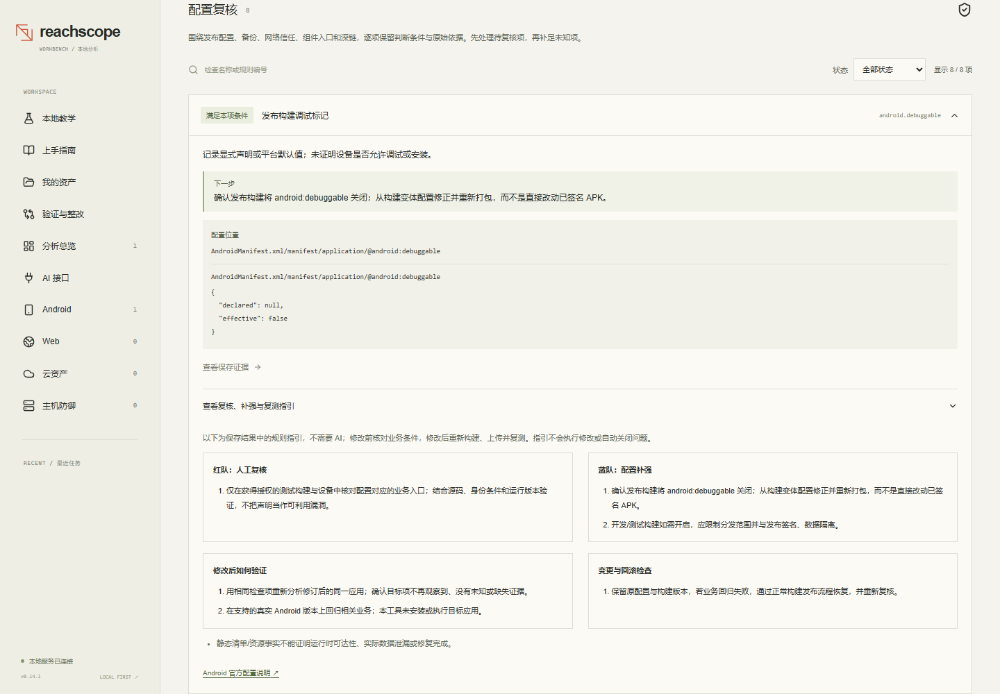

# Android deepening — implementation record

Updated: 2026-11-02. Baseline: 0.11.0, schema 6.

## Delivery order

1. Deepen Android first: bounded static configuration review, evidence-linked
   manual review/hardening guidance, useful result navigation and comparable
   revised-input retests. Preserve existing code-path and source-reader features.
2. After Android acceptance, improve the Web/cloud handoff using the same
   evidence-first workflow. Offline cloud configuration does not prove deployed
   reachability or effective IAM access.

## Android acceptance scope

- The existing manifest/code_paths selections remain real execution choices.
- Review release flags, backup declarations, network-security declarations,
  component exposure/permission boundaries and deep-link declarations.
- Preserve platform-version defaults, missing resource/SDK information and
  runtime-only questions as explicit uncertainty.
- Results distinguish pass, review, unknown and not_applicable. A static pass
  applies only to its stated declaration, never overall application security.
- New configuration cases bind stable rule/resource identities to saved evidence.
  Only a comparable later known pass supports human resolution; removed input,
  unknown data or skipped checks cannot close a case.
- No target APK execution, exploitation, commercial model request or automatic
  configuration change is included in this iteration.

## Verification record

Implementation complete in 0.12.0. The complete source gate passes **1,614 tests**
with one skipped test and **92.31%** coverage; Ruff and strict mypy (111 files)
also pass. Actual compiled, unsigned synthetic APK acceptance completed upload,
manifest-only selection, explicitly related revision, comparable retest and human
closure; full code analysis preserved the same configuration review and one method.
No APK was installed or executed. Android browser acceptance passes 9 checks,
including real source reading, evidence, guidance, mobile and historical result
compatibility. Final aggregate browser/package evidence is in WORKBENCH-VALIDATION.md.
The operator's real-provider deferral remains in force; local protocol fixtures
are not commercial inference acceptance.
